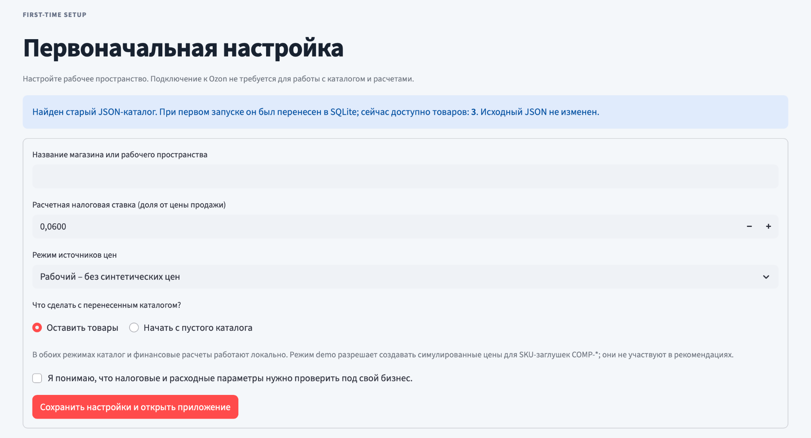
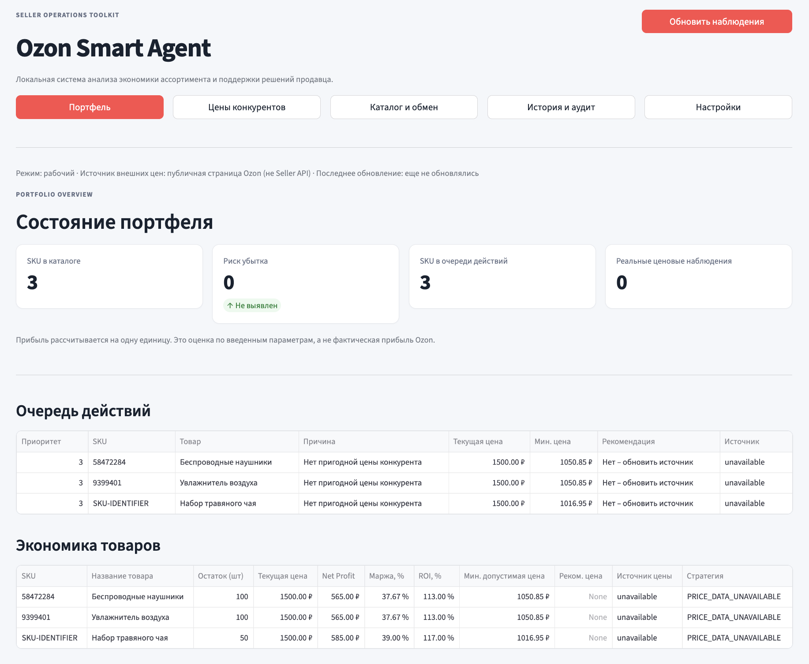
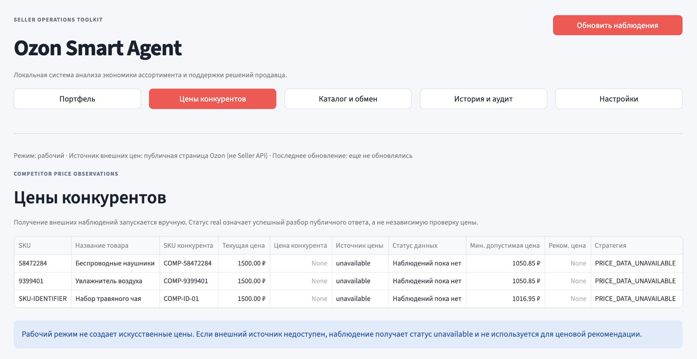
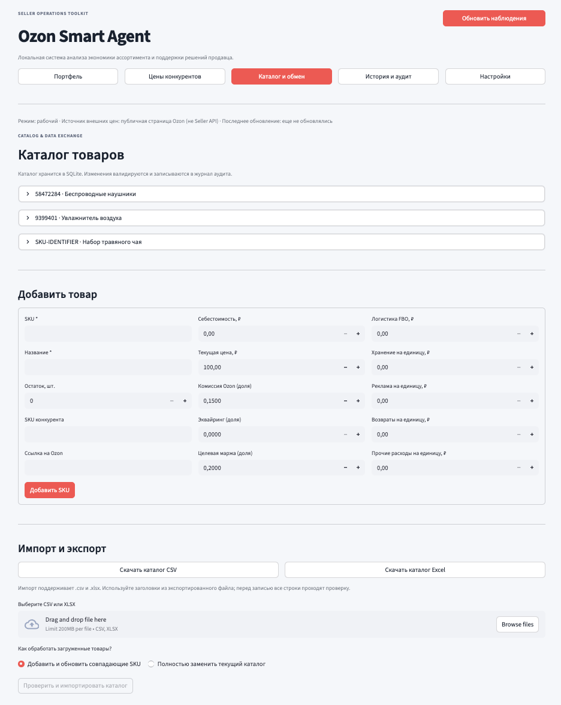
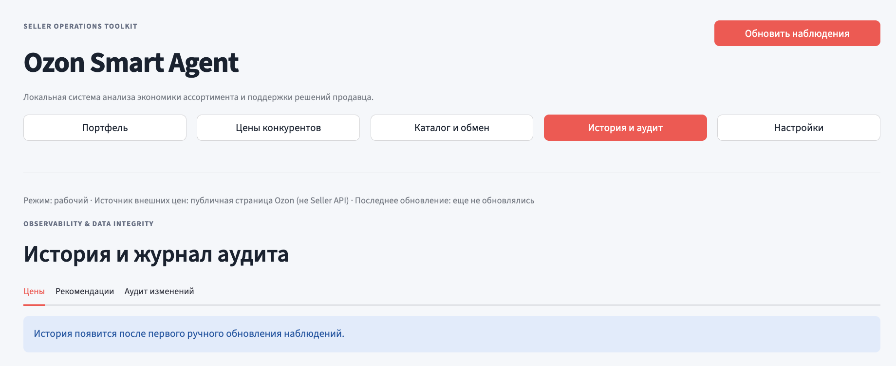
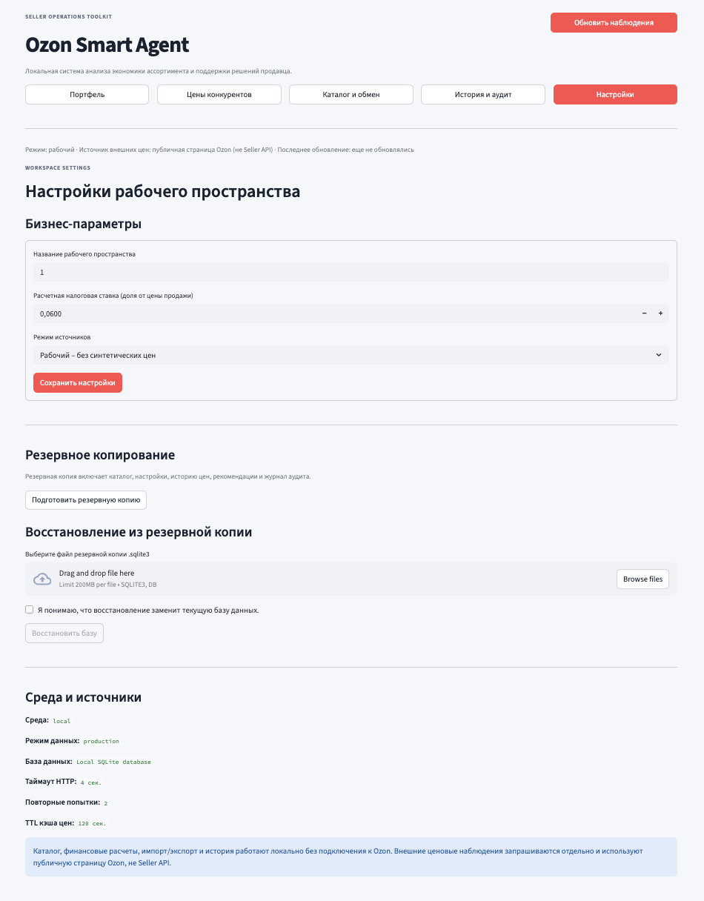

# Ozon Smart Agent

**A local seller-operations toolkit for catalog profitability, competitor price observations, and explainable pricing decisions.** Ozon Smart Agent helps sellers maintain a product catalog, calculate configurable per-unit economics, review optional public-page price observations, and keep an operational history of changes.

> **Status:** practical local MVP, self-hosted template. The app can manage a seller's catalog and calculate unit economics without Ozon API credentials. Competitor observations are optional and currently use an unofficial public-page endpoint. The application does not change prices in an Ozon account.

[Русская версия](README.ru.md)

---

## 1. Project Overview

Ozon Smart Agent is a small local application for sellers who need a repeatable way to review the economics of individual SKUs and manage catalog data. It brings catalog management, configurable cost assumptions, price observations, recommendations, history, and backups into one Streamlit interface.

The application is designed to be useful even without an external API connection:

- create or import a product catalog;
- calculate profit, margin, ROI, break-even price, and minimum price for a target margin;
- export the catalog to CSV or Excel;
- keep a local history of price observations and pricing recommendations;
- review an audit log of catalog and workspace changes;
- back up and restore the local SQLite database.

It is a **decision-support tool**, not an autonomous repricer or an official Ozon product. The seller reviews recommendations and makes all marketplace decisions.

The current release focuses on product foundations and data integrity: persistent local storage, validated data exchange, operational history, auditability, and recoverable backups.

## 2. Key Features

### Catalog and data exchange

- Create, update, and delete SKU records.
- Import `.csv` and `.xlsx` catalogs with validation before writing.
- Choose between merge mode (update matching SKU and add new SKU) and replace mode (replace the full catalog).
- Export the current catalog to CSV or Excel.
- Accept English field names and common Russian column aliases.

### Unit economics

For each SKU the application calculates:

- profit per unit;
- margin relative to the current selling price;
- ROI relative to product cost;
- break-even price;
- minimum price for the configured target margin;
- the estimated effect of configurable per-unit expenses.

The model includes product cost, marketplace commission, FBO logistics, tax rate, acquiring rate, storage, advertising, estimated return cost, and other per-unit costs. Monetary calculations use `Decimal` in the shared pricing module.

### Competitor price observations

- Manual price refresh; there is no background polling.
- Explicit `real`, `simulated`, and `unavailable` source statuses.
- Only a successfully parsed `real` observation may be used by the current competitor-based pricing rule.
- Simulated observations are clearly marked and never generate a competitor-based recommendation.

### Recommendation history and audit log

- Save price observations with SKU, competitor SKU, source status, value, and timestamp.
- Save the calculation result, recommendation strategy, and a snapshot of the relevant SKU inputs and calculated metrics after a manual refresh.
- Record product creation, updates, deletion, catalog imports, price refreshes, settings updates, and database restores.
- Keep historical snapshots even when a product is later removed from the active catalog.

### Backup and restore

- Download a consistent SQLite backup.
- Validate a backup before restore using SQLite integrity and schema checks.
- Restore through SQLite's backup API to keep database journal files consistent.
- Create a uniquely named safety backup of the current database before restore.

### First-run setup

On first launch, a setup screen asks for a workspace name, a tax-rate assumption, and the data mode. The existing `data/portfolio_ozon.json` is imported into SQLite once, when present. The source JSON is left unchanged.

## 3. Dashboard Preview

The dashboard contains five sections: Portfolio, Competitor Prices, Catalog & Data Exchange, History & Audit, and Settings.

## Screenshots

### First-time setup


### Portfolio


### Competitor prices


### Product catalog & data exchange


### History & audit


### Workspace settings


## 4. Architecture

The project uses a modular-monolith structure. Streamlit is the presentation layer; domain validation and pricing calculations are separated from SQLite persistence and file import/export.

```text
ozon_smart_agent/
├── app.py                         # Streamlit UI, setup, catalog, history, backup/restore
├── core/
│   ├── analytics.py                # Public-page price observations and unit-economics dataframe
│   ├── import_export.py            # Validated CSV/XLSX import and export
│   ├── pricing.py                  # Decimal financial calculations and pricing rules
│   └── storage.py                  # SQLite schema, JSON migration, history, audit, backup
├── domain/
│   └── validation.py               # Catalog and financial-input validation
├── data/
│   ├── portfolio_ozon.json         # Legacy/sample catalog; imported once if present
│   └── ozon_smart_agent.sqlite3    # Runtime database; generated on first launch
├── docs/images/                    # Dashboard screenshots
├── tests/                          # Pricing, validation, storage, import/export, analytics tests
├── .github/workflows/ci.yml        # Automated CI on push and pull request
├── .streamlit/config.toml          # Streamlit runtime configuration
├── .dockerignore
├── .env.example
├── .gitignore
├── Dockerfile
├── docker-compose.yml
├── LICENSE                         # Project license
├── pyproject.toml
├── requirements.in
├── requirements.txt
├── requirements-dev.txt
├── requirements.lock
├── README.md
└── README.ru.md
```

### Data flow

```text
CSV / XLSX / legacy JSON
          |
          v
  Domain validation  <---- First-run setup
          |
          v
  SQLite catalog + workspace settings
          |
          +------> Audit log
          |
          +------> Unit economics (Decimal)
          |
          +------> Optional public-page price observation
                         |
                         v
               Recommendation calculation
                         |
                         +----> Price history
                         +----> Recommendation history
                         |
                         v
               Portfolio / Action Queue
```

The old JSON file is a migration/import source only. After migration, the application reads and writes the SQLite database. The JSON file is not modified or deleted by the migration.

## 5. Technology Stack

| Technology | Purpose |
|---|---|
| Python 3.11+ | Application and domain logic |
| Streamlit 1.50.0 | Local web interface and first-run setup |
| Pandas 2.3.3 | Tabular analytics and dashboard views |
| NumPy 2.3.4 | Demonstration-only price variation |
| Requests 2.32.5 | Optional HTTP requests to the public Ozon page endpoint |
| Cachetools 6.2.1 | In-memory TTL cache for price observations |
| Openpyxl 3.1.5 | Excel catalog import/export |
| SQLite | Local persistent catalog, observations, recommendations, settings, and audit log |
| Decimal | Monetary arithmetic |
| Pytest 8.4.2 | Automated tests |
| Docker / Docker Compose | Repeatable container launch |
| GitHub Actions | CI tests and Docker image build |

`requirements.lock` pins direct runtime dependencies for the Docker image. It is not a fully resolved transitive lock with hashes.

## 6. Data Sources & Reliability

The application separates seller-entered catalog data from optional competitor observations.

### Local catalog data

Product data is entered manually or imported from CSV/XLSX. It is stored in `data/ozon_smart_agent.sqlite3`. No Ozon connection is required to edit the catalog, calculate unit economics, import/export files, view history, or create backups.

### Price observation statuses

| Status | Meaning | Used for a competitor-based recommendation? |
|---|---|---:|
| `real` | A numeric value was parsed from the expected widget in a response from Ozon's public page endpoint. | Yes |
| `simulated` | A synthetic demonstration value was generated locally for a `COMP-*` placeholder SKU while demo mode is enabled. | **No** |
| `unavailable` | No usable price was retrieved or no competitor SKU was provided. | **No** |

`real` means **parsed**, not independently verified. It does not guarantee that the price is current, stable, comparable, or associated with an in-stock offer.

### Data modes

- `production` is the default. Synthetic competitor prices are not generated. Catalog and financial features work locally; optional manual price refresh can still query the public endpoint for non-placeholder competitor SKUs.
- `demo` permits synthetic prices for `COMP-*` placeholder SKUs. Those values are marked `simulated` and excluded from competitor-based recommendations.

The mode is selected during first-run setup and can be changed in Settings. The initial default can also be set with `DATA_MODE` before the database is created.

### External endpoint

The current optional lookup uses an unofficial public Ozon page endpoint and parses the expected `webPrice` widget. This is **not the official Ozon Seller API** and is not a documented contract for seller operations. Endpoint URL, payload shape, access rules, and availability may change without notice.

HTTP requests use connect/read timeouts, retries for selected temporary status codes, backoff, `Retry-After` support, and an in-memory TTL cache. The cache is temporary and is cleared when the app process/session is restarted. Persistent observation history is stored in SQLite after a manual refresh.

### Financial model assumptions

Commission, acquiring, and tax are treated as fractions of the selling price. Product cost, logistics, storage, advertising, estimated return cost, and other costs are treated as per-unit amounts. This is a configurable estimate, not an Ozon settlement statement, accounting system, or tax calculation. Verify expense categories and rates against the seller's actual contract, reports, category, fulfilment model, and tax regime. Avoid double-counting charges already included in another input.

## 7. Installation & Launch

### Requirements

- Python 3.11 or later for local execution;
- Docker Engine and Docker Compose plugin for container execution;
- macOS, Linux, or Windows.

### Option A – Local launch

```bash
python3.12 -m venv .venv
source .venv/bin/activate
python -m pip install --upgrade pip
python -m pip install -r requirements-dev.txt
python -m streamlit run app.py
```

Open [http://localhost:8501](http://localhost:8501).

On the first run, complete the setup form. The app creates `data/ozon_smart_agent.sqlite3`. If `data/portfolio_ozon.json` exists and has not been migrated before, it is imported once.

### Option B – Docker Compose

```bash
docker compose up --build -d
```

Open [http://127.0.0.1:8501](http://127.0.0.1:8501).

Useful commands:

```bash
# Check container status
docker compose ps

# Follow application logs
docker compose logs -f ozon-agent

# Rebuild after changing application code
docker compose up -d --build ozon-agent

# Stop the container; the mounted data/ directory is preserved
docker compose down
```

### Updating an existing JSON-based installation

If you are upgrading an existing Ozon Smart Agent checkout from the JSON-based version, follow this sequence to protect the seller catalog:

1. Stop the running container with `docker compose down`. Do **not** use `docker compose down -v`; the application data must be preserved.
2. Make a separate copy of the entire local `data/` directory. Keep `data/portfolio_ozon.json` and any existing database or backups.
3. Copy the new application files over the existing repository. Preserve your local `.env` file; review it against `.env.example` and use `DATA_MODE=production` unless you explicitly need demo data.
4. Install the updated dependencies (local run) or rebuild the Docker image:

   ```bash
   python -m pip install -r requirements-dev.txt
   python -m pytest -q
   # or, for Docker:
   docker compose up -d --build ozon-agent
   ```

5. Start the application and complete the first-run setup. If the SQLite database does not yet exist and the legacy JSON catalog has not been migrated, the application imports the catalog once and displays the imported product count. Choose to keep the imported products unless you intentionally want an empty catalog.
6. Check several product records and their financial inputs before using the calculations. The original JSON file remains unchanged and can be kept as a fallback until the migration is verified.
7. Open **Settings → Backup** and download a fresh SQLite backup after confirming the catalog.

The one-time migration is tracked inside SQLite. If the old JSON file is invalid, migration stops with an error rather than silently discarding it. Fix or restore the JSON from your pre-upgrade copy, then start the application again.

### Environment variables

| Variable | Default | Purpose |
|---|---|---|
| `APP_ENV` | `local` | Environment label shown in Settings |
| `DATA_MODE` | `production` | Initial data mode for a new database; `demo` enables synthetic placeholder observations |
| `DATABASE_PATH` | `data/ozon_smart_agent.sqlite3` | SQLite database path |
| `OZON_REQUEST_TIMEOUT` | `4` | HTTP connect/read timeout in seconds |
| `OZON_RETRY_TOTAL` | `2` | Retry count for selected temporary GET failures |
| `PRICE_CACHE_TTL_SECONDS` | `120` | In-memory price-observation cache lifetime |
| `LOG_LEVEL` | `INFO` | Application log level |

Copy `.env.example` to `.env` only when you need to override defaults. Never commit `.env`, API credentials, private database files, or real seller data.

## 8. Testing

Install development dependencies and run tests from the repository root:

```bash
python -m pip install -r requirements-dev.txt
python -m pytest -q
```

The test suite covers:

- Decimal calculations for profit, margin, ROI, break-even price, and minimum price;
- extended percentage and per-unit expenses;
- catalog validation and impossible pricing combinations;
- real/simulated/unavailable source behavior;
- one-time migration from legacy JSON;
- SQLite catalog operations, audit events, and history;
- backup creation and restore validation;
- CSV/XLSX round trips, Russian header aliases, and duplicate SKU rejection.

GitHub Actions runs compilation and tests on Python 3.11 and 3.12 and builds the Docker image for pushes and pull requests. A passing unit-test suite does not replace browser smoke tests or a pilot with a real seller catalog.

## 9. Limitations

- There is no official Ozon Seller API integration or seller-account authentication.
- The optional competitor lookup uses an unofficial public-page endpoint and may stop working if Ozon changes it.
- No price is created, changed, or published on Ozon.
- The `real` status reflects successful parsing only; it is not independent verification.
- The financial model is configurable but simplified. It does not automatically import current tariffs, discounts, promotions, acquiring terms, returns, storage charges, or seller-specific tax rules from Ozon reports.
- The model calculates estimated profit per unit; there is no sales or demand forecast, actual settlement reconciliation, or portfolio-level profit forecast.
- CSV/XLSX import validates the catalog schema but does not infer category-specific commission or fulfilment tariffs.
- SQLite is a local single-user store. There is no multi-user concurrency model, authentication, role-based access, or remote tenant isolation.
- Price refresh is manual. There is no scheduler or notification service.
- The SEO helper from the previous prototype is not an AI workflow; no LLM is connected.

Keep the dashboard bound to localhost unless you add authentication, authorization, TLS, and an operational security model.

## 10. Roadmap

1. Expand financial profiles with category/fulfilment tariff sets and reconciliation against seller reports.
2. Add official Ozon Seller API integration with explicit scopes, encrypted secret storage, rate-limit handling, and read-only mode first.
3. Add inventory velocity and days-of-stock analysis when reliable sales history is available.
4. Add configurable pricing scenarios and explainable recommendation rules.
5. Improve migrations, database maintenance, and backup retention.
6. Add browser-level smoke tests and release packaging for non-developer users.
7. Consider controlled price updates only after permission checks, audit, safety limits, and explicit human confirmation.

---

## Important Notice

Ozon Smart Agent is an independent project. It is not affiliated with, endorsed by, or an official product of Ozon. All calculations and recommendations are estimates and must be checked against the seller's current commercial terms, source reports, actual expenses, and business requirements.
