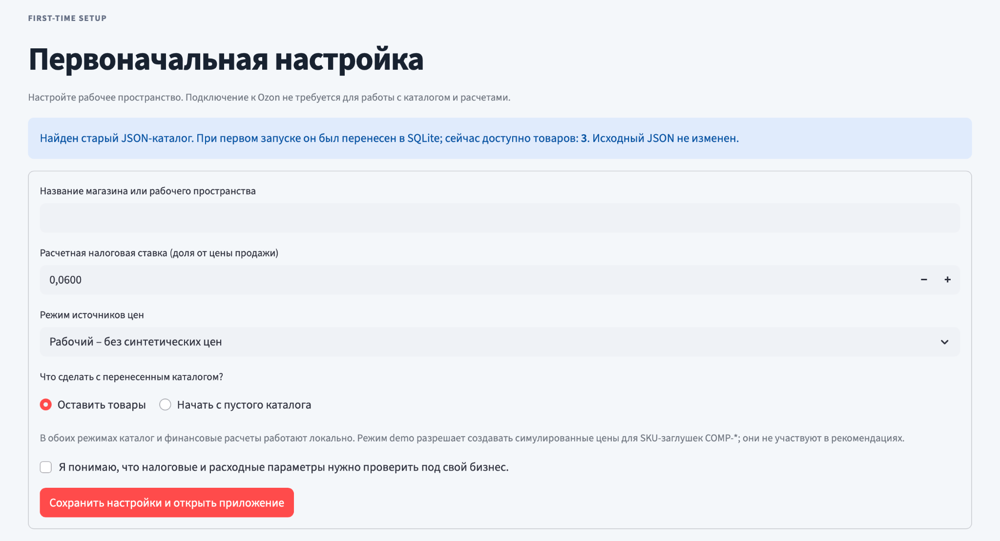
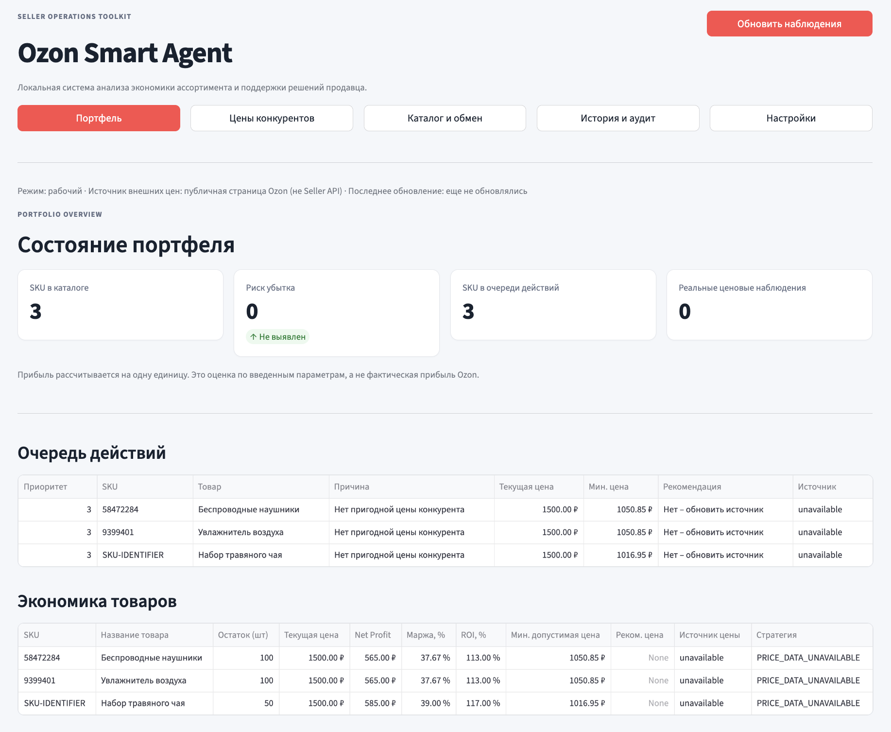
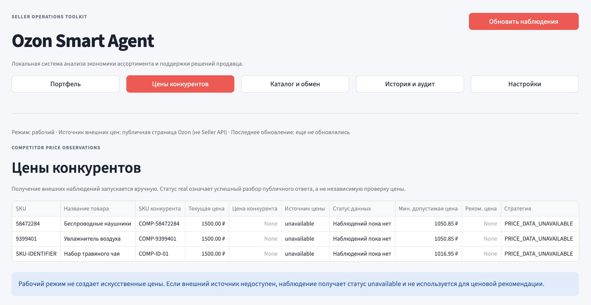
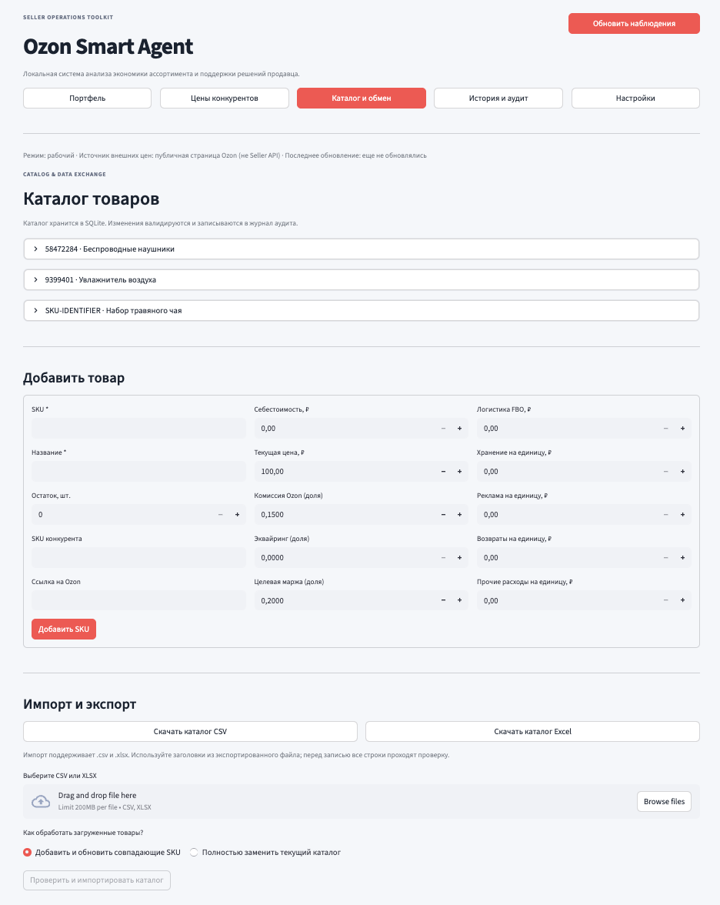
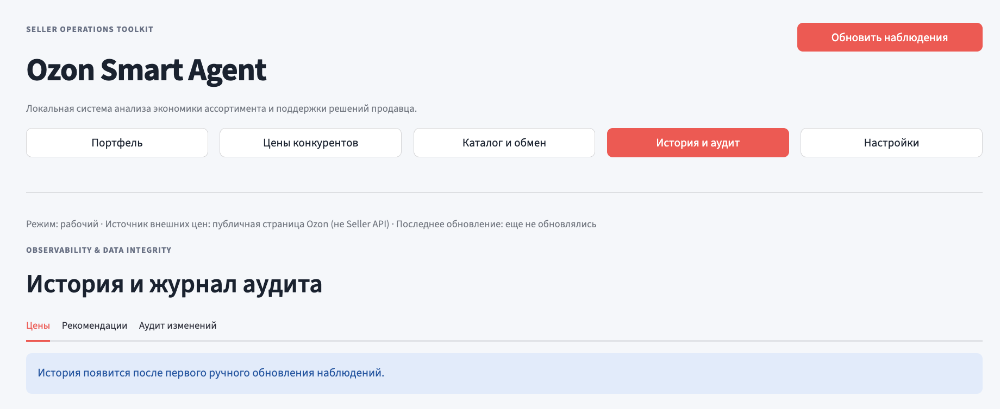
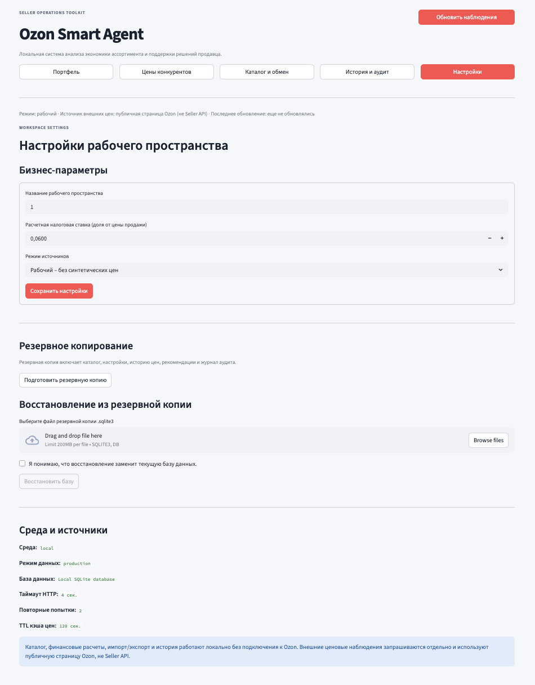

# Ozon Smart Agent

**Локальный инструмент для управления каталогом, расчета экономики товаров и поддержки ценовых решений продавца Ozon.** Приложение объединяет каталог SKU, настраиваемые расходы, наблюдения за ценами конкурентов, рекомендации, историю операций и резервное копирование в одном интерфейсе Streamlit.

> **Статус:** практический локальный MVP, шаблон для самостоятельного размещения. Каталог и финансовые расчеты работают без API-ключей Ozon. Получение цен конкурентов – дополнительная функция на основе неофициального публичного endpoint. Приложение не меняет цены в кабинете Ozon.

[English version](README.md)

---

## 1. Что такое Ozon Smart Agent

Ozon Smart Agent помогает продавцу регулярно проверять экономику отдельных товаров и управлять каталогом. В одном приложении можно вести SKU, задавать затраты, рассчитывать прибыльность, импортировать и экспортировать товары, сохранять историю ценовых наблюдений и рекомендаций, а также делать резервные копии.

Для основной работы подключение к Ozon не требуется:

- добавляйте товары вручную или импортируйте каталог из CSV/Excel;
- рассчитывайте прибыль, маржу, ROI, безубыточную цену и минимальную цену для целевой маржи;
- выгружайте каталог в CSV или Excel;
- храните историю ценовых наблюдений и рекомендаций;
- просматривайте журнал изменений каталога и настроек;
- создавайте резервную копию SQLite и восстанавливайте данные.

Это **инструмент поддержки решений**, а не автоматический репрайсер и не официальный продукт Ozon. Все рекомендации проверяет продавец.

Текущая версия сосредоточена на основе рабочего продукта и целостности данных: постоянном локальном хранении, проверяемом обмене данными, истории операций, аудите и резервном копировании с возможностью восстановления.

## 2. Основные возможности

### Каталог и обмен данными

- Добавление, изменение и удаление SKU.
- Импорт `.csv` и `.xlsx` с проверкой данных до записи.
- Два режима импорта: объединить с текущим каталогом или полностью заменить его.
- Экспорт каталога в CSV и Excel.
- Поддержка английских названий колонок и распространенных русских заголовков.

### Юнит-экономика

Для каждого SKU рассчитываются:

- прибыль с одной единицы;
- маржа относительно текущей цены продажи;
- ROI относительно себестоимости;
- цена безубыточности;
- минимальная цена для заданной целевой маржи;
- влияние дополнительных расходов на единицу товара.

Модель учитывает себестоимость, комиссию маркетплейса, логистику FBO, налоговую ставку, эквайринг, хранение, рекламу, оценку расходов на возвраты и прочие затраты на единицу. Денежные вычисления выполняются через `Decimal` в общем модуле расчетов.

### Наблюдения за ценами конкурентов

- Ручное обновление цен; фонового опроса пока нет.
- Отдельные статусы источника: `real`, `simulated`, `unavailable`.
- Только успешно разобранное наблюдение `real` может использоваться текущим правилом ценовой рекомендации.
- Симулированные значения явно помечаются и не формируют рекомендацию по цене конкурента.

### История рекомендаций и журнал аудита

- Сохранение ценовых наблюдений с SKU, SKU конкурента, источником, статусом, значением и временем получения.
- Сохранение результата расчета, ценовой стратегии и снимка исходных параметров SKU и рассчитанных показателей после ручного обновления.
- Журнал создания, изменения и удаления товаров, импорта каталога, обновления цен, изменения настроек и восстановления базы.
- Исторические записи сохраняются, даже если товар удален из активного каталога.

### Резервное копирование и восстановление

- Скачивание согласованной резервной копии SQLite.
- Проверка целостности и версии схемы перед восстановлением.
- Восстановление через SQLite Backup API, чтобы согласованно обновлять базу и ее служебные файлы.
- Автоматическое создание отдельной резервной копии текущей базы перед восстановлением.

### Первоначальная настройка

При первом запуске приложение просит указать название рабочего пространства, налоговую ставку для расчета и режим данных. Если найден старый файл `data/portfolio_ozon.json`, он один раз импортируется в SQLite. Исходный JSON остается без изменений.

## 3. Интерфейс приложения

В приложении пять основных разделов: «Портфель», «Цены конкурентов», «Каталог и обмен», «История и аудит», «Настройки».

## Скриншоты

### Первоначальная настройка


### Портфель


### Цены конкурентов


### Каталог и обмен данными


### История и журнал аудита


### Настройки рабочего пространства


## 4. Архитектура проекта

Проект построен как модульный монолит. Streamlit отвечает за интерфейс, доменная валидация и финансовые расчеты отделены от SQLite-хранилища и импорта/экспорта файлов.

```text
ozon_smart_agent/
├── app.py                          # интерфейс, первоначальная настройка, каталог, история, backup/restore
├── core/
│   ├── analytics.py                # наблюдения публичных цен и расчеты по SKU
│   ├── import_export.py            # проверенный импорт/экспорт CSV и XLSX
│   ├── pricing.py                  # финансовые расчеты на Decimal и ценовые правила
│   └── storage.py                  # SQLite, миграция JSON, история, аудит, резервные копии
├── domain/
│   └── validation.py               # проверка каталога и финансовых параметров
├── data/
│   ├── portfolio_ozon.json         # старый/примерный каталог; однократный источник миграции
│   └── ozon_smart_agent.sqlite3    # рабочая база; создается при первом запуске
├── docs/images/                    # скриншоты панели
├── tests/                          # тесты расчетов, валидации, хранения, обмена данными и аналитики
├── .github/workflows/ci.yml        # автоматические проверки GitHub Actions
├── .streamlit/config.toml          # настройки Streamlit
├── .dockerignore
├── .env.example
├── .gitignore
├── Dockerfile
├── docker-compose.yml
├── LICENSE                         # лицензия проекта
├── pyproject.toml
├── requirements.in
├── requirements.txt
├── requirements-dev.txt
├── requirements.lock
├── README.md
└── README.ru.md
```

### Как проходят данные через приложение

```text
CSV / XLSX / старый JSON
          |
          v
     Доменная проверка  <---- Первоначальная настройка
          |
          v
  SQLite: каталог и настройки
          |
          +------> Журнал аудита
          |
          +------> Расчет юнит-экономики (Decimal)
          |
          +------> Необязательное публичное наблюдение цены
                         |
                         v
                 Расчет рекомендации
                         |
                         +----> История цен
                         +----> История рекомендаций
                         |
                         v
               Портфель и очередь действий
```

Старый JSON используется только как источник однократной миграции. После переноса приложение читает и записывает SQLite. JSON не удаляется и не перезаписывается.

## 5. Технологии

| Технология | Назначение |
|---|---|
| Python 3.11+ | Основной язык и бизнес-логика |
| Streamlit 1.50.0 | Локальная панель и первоначальная настройка |
| Pandas 2.3.3 | Таблицы и аналитика по SKU |
| NumPy 2.3.4 | Вариация демонстрационных цен |
| Requests 2.32.5 | Необязательные HTTP-запросы к публичной странице Ozon |
| Cachetools 6.2.1 | Временный TTL-кэш наблюдений |
| Openpyxl 3.1.5 | Импорт и экспорт Excel |
| SQLite | Каталог, настройки, наблюдения, рекомендации и аудит |
| Decimal | Денежные вычисления |
| Pytest 8.4.2 | Автоматические тесты |
| Docker / Docker Compose | Контейнерный запуск |
| GitHub Actions | CI-проверки |

`requirements.lock` фиксирует прямые runtime-зависимости для Docker-образа. Это пока не полный lock-файл всех транзитивных зависимостей с хешами.

## 6. Источники данных и надежность

Приложение разделяет данные каталога, введенные продавцом, и необязательные наблюдения за ценами конкурентов.

### Локальный каталог

Товары добавляются вручную или импортируются из CSV/XLSX. Они хранятся в `data/ozon_smart_agent.sqlite3`. Для управления каталогом, расчетов, импорта/экспорта, истории и резервного копирования подключение к Ozon не требуется.

### Статусы наблюдений

| Статус | Что означает | Используется в ценовой рекомендации? |
|---|---|---:|
| `real` | Из ответа публичного endpoint страницы Ozon удалось разобрать числовое значение из ожидаемого виджета. | Да |
| `simulated` | Локально создано демонстрационное значение для SKU-заглушки `COMP-*`, когда включен демо-режим. | **Нет** |
| `unavailable` | Пригодную цену получить не удалось или SKU конкурента не указан. | **Нет** |

`real` означает **успешно разобрано**, а не независимо проверено. Это не гарантия актуальности, стабильности, наличия товара или сопоставимости предложения.

### Режимы данных

- `production` – режим по умолчанию. Синтетические цены не создаются. Каталог и финансовые расчеты работают локально; ручное обновление может обращаться к публичному endpoint для обычных SKU конкурентов.
- `demo` – разрешает создавать синтетические цены для SKU-заглушек `COMP-*`. Такие значения помечаются как `simulated` и не участвуют в ценовых рекомендациях.

Режим выбирается при первоначальной настройке и меняется в разделе «Настройки». Для новой базы его также можно задать переменной `DATA_MODE` до первого запуска.

### Внешний endpoint

Для необязательного получения цен используется неофициальный публичный endpoint страницы Ozon, из ответа которого приложение пытается разобрать виджет `webPrice`. Это **не официальный Ozon Seller API** и не документированный контракт для операций продавца. Адрес endpoint, структура ответа, правила доступа и доступность могут измениться без предупреждения.

HTTP-клиент использует таймауты подключения и чтения, повторные попытки при отдельных временных ошибках, backoff, поддержку `Retry-After` и временный TTL-кэш в памяти. Кэш очищается после перезапуска приложения. История наблюдений сохраняется в SQLite после ручного обновления.

### Допущения финансовой модели

Комиссия, эквайринг и налог задаются долями от цены продажи. Себестоимость, логистика, хранение, реклама, оценка расходов на возвраты и прочие расходы задаются суммой на одну проданную единицу. Это настраиваемая оценка, а не отчет о взаиморасчетах Ozon, бухгалтерская система или налоговый расчет. Проверьте состав расходов и ставки по договору продавца, отчетам, категории, схеме исполнения и налоговому режиму. Не учитывайте одну и ту же комиссию или услугу дважды.

## 7. Установка и запуск

### Что понадобится

- Python 3.11 или новее для локального запуска;
- Docker Engine и Docker Compose для запуска в контейнере;
- macOS, Linux или Windows.

### Вариант A – локальный запуск

```bash
python3.12 -m venv .venv
source .venv/bin/activate
python -m pip install --upgrade pip
python -m pip install -r requirements-dev.txt
python -m streamlit run app.py
```

Откройте [http://localhost:8501](http://localhost:8501).

При первом запуске заполните форму настройки. Приложение создаст `data/ozon_smart_agent.sqlite3`. Если существует `data/portfolio_ozon.json` и он еще не переносился, каталог будет импортирован один раз.

### Вариант B – Docker Compose

```bash
docker compose up --build -d
```

Откройте [http://127.0.0.1:8501](http://127.0.0.1:8501).

Полезные команды:

```bash
# Проверить статус контейнера
docker compose ps

# Смотреть логи приложения
docker compose logs -f ozon-agent

# Пересобрать после изменения кода
docker compose up -d --build ozon-agent

# Остановить контейнер; подключенная папка data/ сохранится
docker compose down
```

### Обновление с JSON-версии на SQLite

Если Вы обновляете уже работающий Ozon Smart Agent с версии, в которой каталог хранился в JSON, выполните шаги в этом порядке, чтобы сохранить данные:

1. Остановите контейнер командой `docker compose down`. **Не используйте `docker compose down -v`**: данные приложения нужно сохранить.
2. Сделайте отдельную копию всей локальной папки `data/`. Сохраните `data/portfolio_ozon.json`, существующую базу SQLite (если она уже есть) и резервные копии.
3. Скопируйте новые файлы приложения поверх существующего репозитория. Не перезаписывайте свой локальный `.env`; сверьте его с `.env.example`. Оставьте `DATA_MODE=production`, если Вам специально не нужны демонстрационные данные.
4. Установите обновленные зависимости (для локального запуска) или пересоберите Docker-образ:

   ```bash
   python -m pip install -r requirements-dev.txt
   python -m pytest -q
   # или, для Docker:
   docker compose up -d --build ozon-agent
   ```

5. Запустите приложение и завершите первоначальную настройку. Если база SQLite еще не создана и старый JSON-каталог ранее не переносился, приложение импортирует каталог один раз и покажет количество перенесенных товаров. Выберите сохранение товаров, если не планируете намеренно начинать с пустого каталога.
6. Проверьте несколько товаров и их финансовые параметры, прежде чем использовать расчеты. Исходный JSON остается без изменений; сохраните его как резервный вариант, пока не убедитесь, что миграция прошла корректно.
7. Откройте **«Настройки → Резервное копирование»** и скачайте новую резервную копию SQLite после проверки каталога.

Факт однократной миграции хранится внутри SQLite. Если старый JSON не проходит проверку, приложение остановит миграцию с сообщением об ошибке, а не будет молча отбрасывать данные. Исправьте JSON или восстановите его из копии до повторного запуска приложения.

### Переменные окружения

| Переменная | Значение по умолчанию | Назначение |
|---|---|---|
| `APP_ENV` | `local` | Название среды в настройках |
| `DATA_MODE` | `production` | Начальный режим новой базы: `production` или `demo` |
| `DATABASE_PATH` | `data/ozon_smart_agent.sqlite3` | Путь к SQLite |
| `OZON_REQUEST_TIMEOUT` | `4` | Таймаут подключения и чтения, секунды |
| `OZON_RETRY_TOTAL` | `2` | Повторы отдельных временных GET-ошибок |
| `PRICE_CACHE_TTL_SECONDS` | `120` | Время хранения наблюдения в кэше памяти |
| `LOG_LEVEL` | `INFO` | Уровень логирования |

Копируйте `.env.example` в `.env`, только если нужно переопределить настройки. Не публикуйте `.env`, API-ключи, личные базы и реальные коммерческие данные.

## 8. Тестирование

Установите зависимости для разработки и запустите тесты из корня репозитория:

```bash
python -m pip install -r requirements-dev.txt
python -m pytest -q
```

Набор проверяет:

- расчеты прибыли, маржи, ROI, цены безубыточности и минимальной цены через `Decimal`;
- дополнительные процентные и фиксированные расходы на единицу;
- проверку каталога и невозможных сочетаний ценовых параметров;
- поведение источников `real` / `simulated` / `unavailable`;
- однократную миграцию старого JSON;
- операции SQLite, аудит и историю;
- создание резервной копии и проверку восстановления;
- импорт/экспорт CSV/XLSX, русские заголовки и проверку повторных SKU.

GitHub Actions запускает компиляцию и тесты на Python 3.11 и 3.12, а также собирает Docker-образ при push и Pull Request. Успешные модульные тесты не заменяют проверку интерфейса в браузере и пилот на реальном каталоге продавца.

## 9. Ограничения

- Нет интеграции с официальным Ozon Seller API и авторизации в кабинете продавца.
- Необязательное получение цен использует неофициальный публичный endpoint и может перестать работать после изменений Ozon.
- Приложение не создает, не меняет и не публикует цены на Ozon.
- Статус `real` означает только успешный разбор ответа, а не независимую проверку цены.
- Финансовая модель настраиваемая, но упрощенная. Тарифы, скидки, акции, возвраты, хранение, эквайринг и налоговые условия автоматически из отчетов Ozon не загружаются.
- Приложение оценивает прибыль на единицу; прогноза продаж и спроса, сверки фактических взаиморасчетов и прогноза прибыли всего портфеля пока нет.
- Импорт CSV/XLSX проверяет структуру каталога, но не определяет тарифы категории и схемы исполнения автоматически.
- SQLite рассчитана на локальное однопользовательское использование. Нет многопользовательского режима, аутентификации и разграничения ролей.
- Обновление цен запускается вручную. Планировщика и системы уведомлений нет.
- SEO-помощник из предыдущего прототипа не является AI-функцией; LLM не подключена.

Оставляйте приложение доступным только локально, пока не будут добавлены аутентификация, разграничение доступа, TLS и модель безопасной эксплуатации.

## 10. План развития

1. Расширить финансовые профили тарифами по категориям и схемам исполнения, добавить сверку с отчетами продавца.
2. Подключить официальный Ozon Seller API с ограниченными разрешениями, безопасным хранением секретов и обработкой rate limits; сначала – только чтение.
3. Добавить скорость продаж и дни запаса при наличии достоверной истории продаж.
4. Развить сценарное ценообразование и объяснимые правила рекомендаций.
5. Улучшить миграции, обслуживание базы и политику хранения резервных копий.
6. Добавить браузерные smoke-тесты и релизы, удобные для пользователей без опыта разработки.
7. Рассматривать контролируемое изменение цен только после проверок разрешений, аудита, ограничений безопасности и явного подтверждения человеком.

---

## Важное замечание

Ozon Smart Agent – независимый проект. Он не связан с Ozon, не одобрен Ozon и не является официальным продуктом компании. Все расчеты и рекомендации являются оценочными и должны проверяться по актуальным условиям продавца, отчетам, фактическим расходам и особенностям бизнеса.